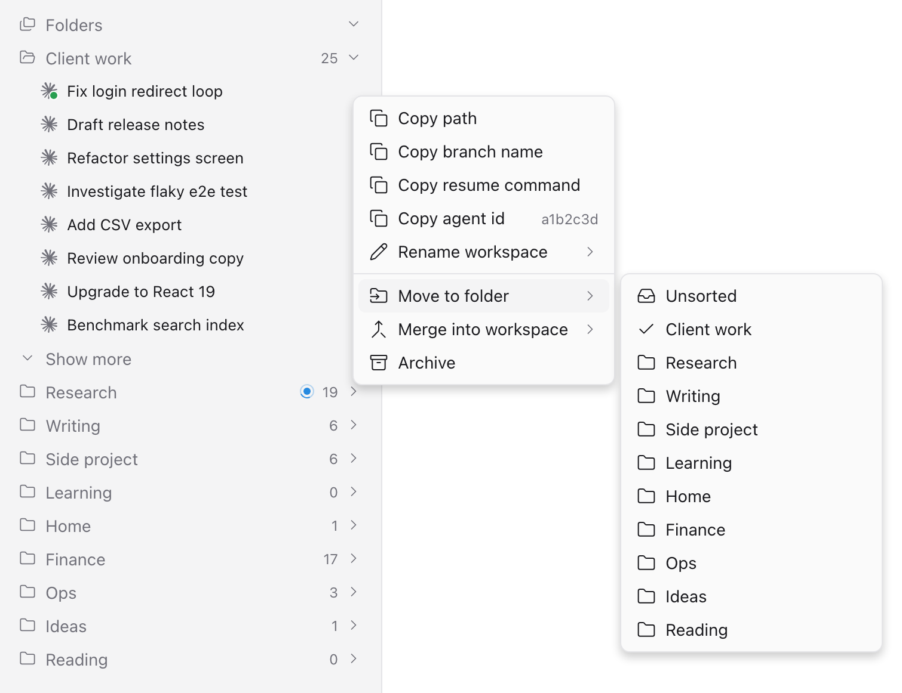

# Folders for Paseo

[English](README.md) | 简体中文

一个 [Paseo](https://paseo.sh) 插件：在侧栏里加上文件夹，让你按主题给工作区分组，而不只是按项目。它还能合并工作区、把对话挪到另一个工作区，这些 Paseo 目前还做不到。



- **文件夹**：把任何项目里的工作区放进侧栏顶部的文件夹，用鼠标在文件夹之间拖动，也可以上下拖动排好顺序。还没放进文件夹的工作区都在 Unsorted（未分类）里。文件夹上方的 **Recent**（最近）列出最近用过的工作区，点一下就到。
- **合并与拆分**：把一个工作区拖到另一个工作区上，两个就合并了，它的对话成为那边的标签页。把单个对话拖到别的工作区上，就把它挪过去；拖到文件夹上，就在那里给它单独建一个工作区。实验性功能。
- **各处一致**：文件夹存在你的 Paseo 主机上，电脑和手机上的 App 看到的是同一套。

Paseo 按项目目录给工作区分组。如果你的工作大多在同一个目录里进行，它们就会挤成一条长长的列表。这个插件在此之上加一层文件夹，不改动项目、工作区和 agent。用上以后，可以把 Paseo 自带列表里的那个项目折叠起来。

## 功能

- 侧栏顶部多出一个 **Folders** 区域：每个文件夹一行，标着里面有几个工作区；不在任何文件夹里的工作区归在 **Unsorted**（未分类），空着也会显示；它默认排在最上面，也可以挪。点文件夹就展开或收起，可以同时展开好几个。展开的文件夹先列出 8 个工作区，其余的用 **Show more** 和 **Show less** 展开、收起。文件夹里的工作区先按最近活动排，新的在上；你拖动排过一次以后，这个文件夹就保持你排的顺序，新进来的工作区放在最上面。每行标题前面都显示 Paseo 的状态（运行中的圆环、需要处理和出错的圆点）；只有一个对话的工作区，还会显示这个对话所用服务（如 Claude、Codex）的标志；列出来的对话也一样，在标题前面显示自己的状态。
- Paseo 正在显示的工作区会高亮，和 Paseo 自己的列表一样。手机原生 App 读不到正在显示的是哪一个，所以在手机上，高亮的是最后一次从文件夹里打开的工作区。
- 文件夹上方的 **Recent**（最近）列出你最近用过的工作区，不管它们放在哪个文件夹，正在处理的那几个点一下就到。在 Paseo 里置顶的排在最前，最后置顶的在最上面；其余的按你最后一次在里面发消息的时间排，新的在上，一共 8 个。置顶的，以及有东西要看的（没读的回复、等你回答的问题、出错或正在运行），超过 8 个也不会被挤掉。在工作区上点右键，选 **Pin to Recent**（钉在 Recent）或 **Unpin from Recent**（取消钉住）：这就是 Paseo 自己的 **Pin to top**（置顶），所以 Paseo 自己的列表里也会显示置顶。置顶要通过 Paseo 内部的 daemon 客户端完成，和挪动对话一样，Paseo 升级后可能失灵。一个工作区用完了，在它上面点右键，选 **Remove from Recent**（移出 Recent）：之后不管它有什么要看的，都不会再出现在 Recent 里，直到你在里面再发消息或者把它置顶；置顶的会同时取消置顶。Recent 也能像文件夹一样拖动排序：把工作区拖到 Recent 里某个工作区的上沿或下沿，就放在它的上面或下面（会出现一条线，标出松手后的位置）。排过一次以后，Recent 就保持你排的顺序：新置顶或新用到的工作区放在最上面，只是来补空位的放在最下面；想回到“置顶的在前、其余按最后使用排”，在 Recent 里的工作区上点右键，选 **Reset Recent order**（恢复 Recent 原来的排法）。排序不会把工作区留在 Recent 里，置顶才会；从文件夹里把工作区拖到 Recent 的两行之间，会把它置顶并放在那里。和文件夹里一样，有好几个对话的工作区会标出对话数，点数字和箭头就在下面列出这些对话。把工作区或对话拖到 Recent 里某个工作区的正中间，就合并进去，和拖到它在文件夹里的那一行一样。点 **Recent** 可以折叠。
- 鼠标移到文件夹上按 **+**（触屏上，展开的文件夹直接显示这个按钮），就能新建一个已经放在这个文件夹里的工作区。它是本地工作区，建在这个文件夹里多数工作区所在的项目下，打开时是 Paseo 自己的新标签页界面。Paseo 会按创建工作区时输入的提示给它起名；这样新建的工作区一开始是空的，所以它的第一个对话回复以后，会改用这个对话的标题，除非你已经给它起了名字。一直没用的，会以 **New workspace** 的名字留在文件夹里；建好一天后，插件会把它归档，除非它正打开着、开了终端，或者你给它起了名字、置了顶。不会删除任何文件；想早点去掉，就在它上面点右键，选 **Archive**（归档）。要建在别的项目下，或者用 worktree，请用 Paseo 自带的 **New workspace**，建好再挪进来。
- 用鼠标把工作区拖到文件夹上，就挪进这个文件夹；拖到另一个工作区的上沿或下沿，就放在它的上面或下面（会出现一条线，标出松手后的位置；拖到它自己所在的文件夹上，就放到最上面）；拖到另一个工作区的正中间，就合并进那个工作区。有好几个对话的工作区会显示对话数和一个箭头；点它列出这些对话，再把其中一个拖到别的工作区上，就把它挪过去；拖到文件夹上，就在那个文件夹里给它单独建一个工作区。拖动时，目标那一行会出现边框，指针下方的提示说明松手后会发生什么。把指针停在文件夹区的上沿或下沿附近，它就往那边滚动，看不见的行也能拖到。挪进别的项目前会先问你。
- 在侧栏里就能管理文件夹：用鼠标上下拖动文件夹调整顺序（会出现一条线，标出松手后的位置）；按 **Folders** 标题上的新建文件夹按钮添加文件夹；在文件夹上点右键（或按它的 **⋮**，触屏上展开的文件夹会显示这个按钮），可以在里面新建工作区、重命名、在它下面新建文件夹，或者删除它。删除是一点就删，里面的工作区回到 Unsorted。
- 在工作区上点右键（触屏上长按），会弹出仿照 Paseo 工作区菜单的菜单：复制路径、复制分支名、复制恢复命令和 agent id、重命名、**Pin to Recent**（钉在 Recent）、**Remove from Recent**（移出 Recent）和 **Reset Recent order**（恢复 Recent 原来的排法；这两项只对 Recent 里的工作区）、**Move to folder**（挪到文件夹）、**Merge into workspace**（合并进工作区）、**Split off a conversation**（拆出一个对话）、归档。Paseo 里工作区的名字和对话的标题是分开存的，标签页上显示的是对话的标题；所以给只有一个对话的工作区改名时，这个对话也会一起改名，标签页上就是同一个名字。这一步和置顶一样，要通过 Paseo 内部的 daemon 客户端完成。
- 在列出来的对话上点右键（触屏上长按），或者按它的 **⋮**，会弹出仿照 Paseo 标签页菜单的菜单：复制恢复命令、复制 agent id、**Rename conversation**（给对话改名）和 **Move to a new workspace**（挪进一个新工作区）。改名改的是对话的标题，也就是标签页上显示的名字，工作区的名字不变。
- 合并是把一个工作区里的对话挪进另一个工作区，在那里成为标签页，再把变空的工作区归档。拆分是把一个对话挪进旁边新建的工作区。详见[合并与拆分工作区](#合并与拆分工作区实验性)。
- 一个布局仿照 Paseo 设置页的管理页面，用来新建、重命名和删除文件夹，调整顺序（按住一个文件夹再拖动），也能搜索所有工作区和其中的对话。Unsorted 也能像文件夹一样改名、挪位置，但不能删除。
- 可选的建议文件：脚本可以借它给对话提议文件夹，并给每个对话写一行备注。
- 文件夹数据存在主机的 Paseo 插件设置里，所以电脑和手机上的 App 看到的是同一套。

子 agent 和已归档的工作区不会列出。

## 要求

后台服务（daemon）和 App 都需要 Paseo 0.11.1 或更新版本。

## 安装

```bash
paseo plugin install https://github.com/hanableem/paseo-folders.git
```

或者从本地副本安装：

```bash
paseo plugin install /absolute/path/to/paseo-folders
```

Paseo 会请你确认信任这个插件。插件的服务端负责注册设置文档、读取建议文件，并在你合并或拆分工作区时挪动对话。

## 建议文件

默认位置：`<Paseo home>/paseo-folders/suggestions.json`（没设 `PASEO_HOME` 时，Paseo home 是 `~/.paseo`）。也可以在 Folders 页面里改成别的路径。

```json
{
  "version": 1,
  "folders": ["工作", "阅读"],
  "assignments": { "<agent id>": "工作" },
  "notes": { "<agent id>": "显示在标题下方的一行备注" },
  "force": ["<agent id>"]
}
```

| 字段 | 含义 |
| --- | --- |
| `folders` | 文件夹名，按显示顺序排列。还没有的文件夹会新建，已有的保持原位。你删掉的文件夹不会再被建出来，建议放进它的对话也留在原处，直到你自己再建一个同名文件夹。你改过名的文件夹，照样接收按旧名建议进来的对话。 |
| `assignments` | agent ID 对应的文件夹名。你没亲手放过的工作区，会去它多数对话指向的文件夹；有好几个对话、而且名字和某个文件夹完全相同的工作区，会去那个文件夹。 |
| `notes` | agent ID 对应的一句简短备注，显示在标题下方，也能被搜索到。 |
| `force` | 这些 agent ID 的建议文件夹连手动放置也能覆盖，用于用户通过另一个工具要求的挪动。被强制的对话如果是所在工作区里唯一的对话，工作区也会跟着挪。 |

插件在 App 启动时导入一次，之后每十分钟导入一次。导入后什么都没变，就不会保存任何东西。

要把放置结果读回去，脚本可以读主机上插件的设置文档：`<Paseo home>/plugin-settings/<installation id>/folders.json`。`values.workspaceAssignments` 和 `values.workspaceManual` 记着你亲手放置的工作区；`values.autoTitle` 列出从文件夹新建、还在等第一个对话标题的工作区，以及还空着、到时会被归档的工作区。`values.removedFromRecent` 记着你把哪些工作区移出了 Recent，以及移出的时间；`values.recentOrder` 记着你给 Recent 排的顺序（空着表示 Recent 原来的排法）。`values.unsortedName` 和 `values.unsortedAt` 记着你给 Unsorted 起的名字（空着表示默认名）和排在它前面的文件夹数。`values.formerFolderNames` 记着改过名的文件夹的旧名各对应哪个文件夹 ID，`values.deletedFolderNames` 列出你删掉的文件夹的名字。

## 合并与拆分工作区（实验性）

Paseo 目前还不能把标签页从一个工作区挪到另一个工作区。这个插件可以替空闲的对话做到：

- 把一个工作区拖到另一个工作区上，或者右键它选 **Merge into workspace**（同一文件夹里的工作区排在前面，输入文字可以搜索其余的）。
- 打开工作区的对话列表（点它那一行上的数字和箭头），把一个对话拖到另一个工作区上，只挪这一个。
- 把列表里的一个对话拖到文件夹上，就在那里给它单独建一个工作区；或者右键这个对话，选 **Move to a new workspace**（也可以右键它所在的工作区，选 **Split off a conversation**），新工作区会留在同一个文件夹里。

同一个项目里的挪动，一松手就完成。挪进另一个项目前，会先弹出对话框，写明两边的项目名，因为从此以后，这个对话执行的命令和改动的文件都在新项目里。挪完后会打开接收对话的工作区，并列出它的对话。没有自己起过标题的工作区，会保留你松手时它显示的名字；以某个对话命名的工作区（拆分出来的就是这样），在那个对话挪走后，会改用剩下对话里最新那个的名字。

- 在同一个目录里：Paseo 先归档这个对话，再把它的会话导入另一个工作区，沿用同一条 agent 记录，所以对话的 ID、历史、标题、模式和模型都不变。
- 挪进另一个目录（另一个项目）的工作区：只有 Claude 的对话能挪。Claude Code 可以在任何目录下按 ID 恢复会话，并继续写进会话开始时的那份记录，所以历史还在；agent 会拿到新的 Paseo ID，标题、标签、模式、模型、思考选项、所在文件夹和备注都会带过去。删除旧记录前，会先在 `<Paseo home>/paseo-folders/moves/` 下存一份副本。Paseo 删除记录时只通知发起删除的那条连接（[getpaseo/paseo#4870](https://github.com/getpaseo/paseo/issues/4870)），所以旧记录会先归档再删除：归档会通知所有打开的 Paseo 窗口，它们会关掉这个对话的标签页。
- 正在运行、或在等你回答权限请求的对话不会挪；等它结束后再试。
- 挪过来的对话排在最后一个标签页。涉及的工作区留在原来的文件夹里。
- 如果导入失败，对话会放回原处。

这些挪动由插件的服务端通过 Paseo 内部的 daemon 客户端完成，连接的是 `PASEO_WS_URL`，或 Paseo `config.json` 里的监听地址，所以 Paseo 更新后可能失效。下面的脚本能在终端里做同样的事。

## 把一个对话拆成单独的工作区（实验性）

Paseo 目前还不能把标签页挪到另一个工作区。`scripts/split-agent.mjs` 可以替空闲的 agent 做到：在这个 agent 的目录里新建一个本地工作区，归档这个 agent，再把它在服务商那边的会话导入新工作区。Paseo 沿用同一条 agent 记录，所以对话、它的 ID 和历史都完整保留。

```bash
node scripts/split-agent.mjs <agent-id> "<新工作区标题>" --dry-run   # 只显示会挪动什么
node scripts/split-agent.mjs <agent-id> "<新工作区标题>"
```

它会用到 Paseo 内部的 daemon 客户端、`PATH` 里的 `paseo` 命令（或 `PASEO_CLI` 指定的），以及 `PASEO_WS_URL` 上的 daemon（默认 `ws://127.0.0.1:6767/ws`）。如果导入失败，agent 会保持归档，可以在 History 里取消归档。

## 把一个对话挪到另一个项目（实验性）

Paseo 不能改变对话运行所在的目录，所以没法把对话挪到另一个项目。`scripts/move-agent.mjs` 可以替空闲的 Claude agent 做到：在目标目录里新建一个本地工作区，归档并删除这个 agent 的 Paseo 记录，再把它的 Claude 会话导入那里。Claude Code 可以在任何目录下按 ID 恢复会话，并继续写进会话开始时的那份记录，所以历史还在，对话也能接着聊。agent 会拿到新的 Paseo ID；标题、标签、模式、模型和思考选项都会带过去，它在 Folders 里的文件夹和备注也一样。如果旧工作区里已经没有别的对话，它会被归档，新工作区接过它的标题和置顶。

```bash
node scripts/move-agent.mjs <agent-id> <目标目录> --dry-run   # 只显示会挪动什么
node scripts/move-agent.mjs <agent-id> <目标目录>
```

删除任何东西前，脚本会把 Paseo 返回的 agent 原样存到 `<Paseo home>/paseo-folders/moves/` 下。如果导入失败，它会把会话导回旧工作区。和在侧栏里挪动一样，记录先归档再删除，所以打开着的 Paseo 窗口会关掉这个对话的标签页。一次挪一个 agent：和别的 agent 共用工作区的，会得到一个单独的工作区。加载会话时，Claude Code 可能往记录里追加几行它自己的内部记录；如果会话结束时还有后台任务在跑，还会追加一条它们已停止的通知。不会运行新的对话轮次。

## 隐私

- 没有遥测，插件自己不发任何网络请求。
- 只读取设定路径上的那个建议文件。
- 为了合并和拆分工作区，它的服务端会连接你电脑上的 Paseo daemon；每个换了目录的对话，都会在 `<Paseo home>/paseo-folders/moves/` 下存一份副本。
- 不上传任何东西；文件夹数据留在你主机上 Paseo 的设置存储里。

## 开发

```bash
npm install
npm run check   # 类型检查和单元测试
paseo plugin install "$PWD"
paseo plugin reload paseo-folders   # 改动之后
```

单元测试覆盖 `shared/model.ts` 里的文件夹模型，用 Node 自带的测试运行器跑。

想手动试合并，请在任何 agent 之外新建几个用完就删的对话，或者用 `env -u PASEO_AGENT_ID paseo run …`：在 Paseo 的 agent 里执行 `paseo run`，新对话会被标成那个 agent 的子 agent，而 Folders 不列出子 agent。

想不碰 App 窗口就试侧栏，可以无头运行 Paseo 自带的网页客户端：用 Playwright 拦截发往 `http://localhost:6767/` 的请求，用 App 的 `Resources/app-dist` 应答（`/` 和 `/h/…` 返回 `index.html`），其他请求放行，再用 `--disable-features=LocalNetworkAccessChecks` 启动 Chromium。daemon 接受这个来源，客户端会自己连上，插件也会像在 App 里一样从 daemon 加载。文件夹和工作区的行带有以 `paseo-folders-drop:` 开头的元素 ID（Recent 里的工作区行以 `:recent` 结尾），测试可以用它们找到这些行，并用鼠标在它们之间拖动。用这种方法做的挪动会真的生效。

`README.zh-CN.md` 是 `README.md` 的中文翻译，改说明时两份一起改。

## 许可证

MIT，见 [LICENSE](LICENSE)。
